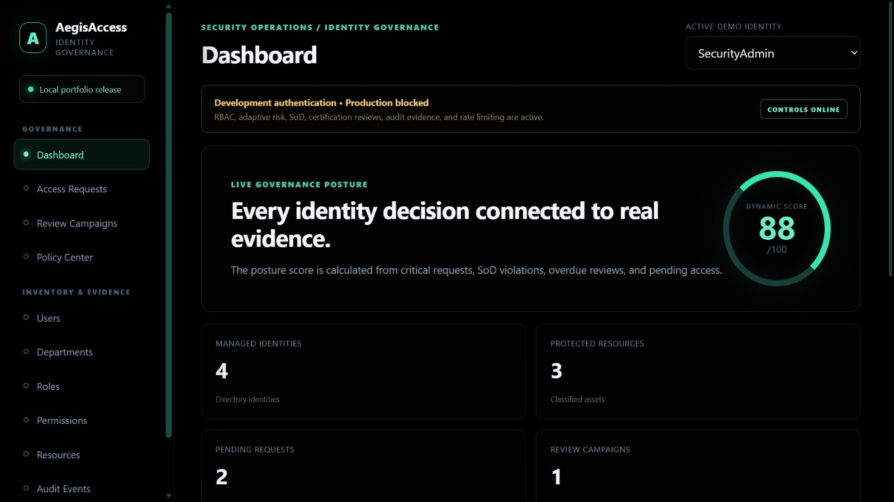
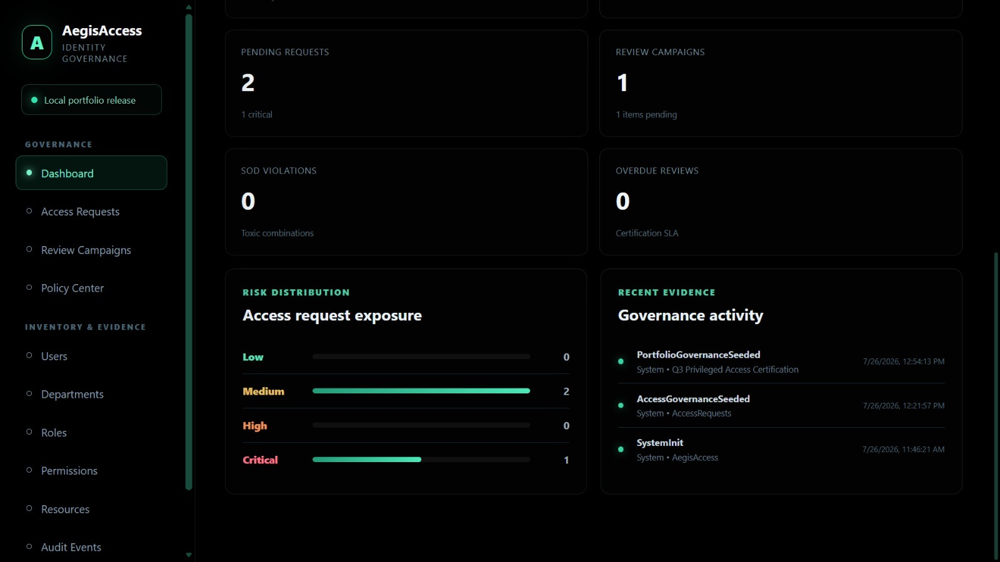
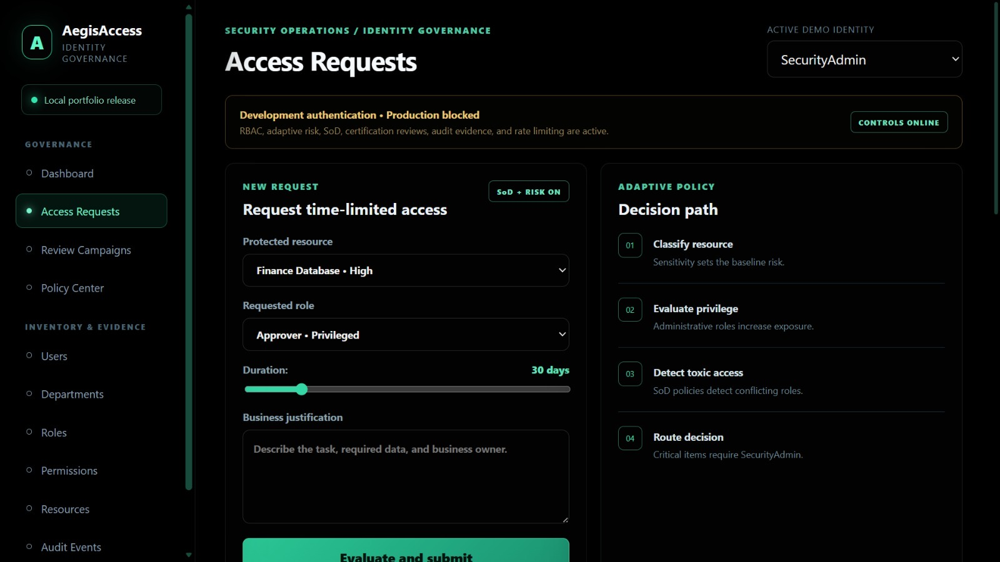
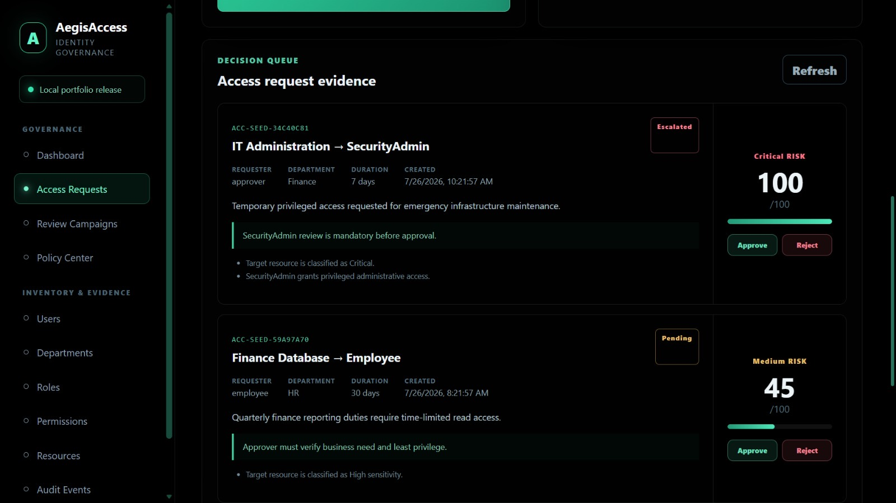
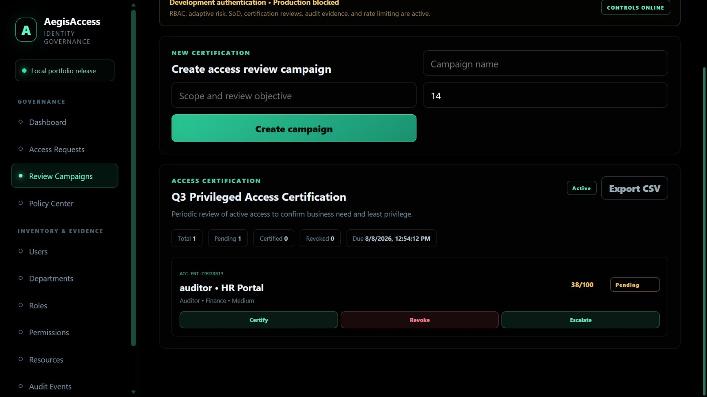
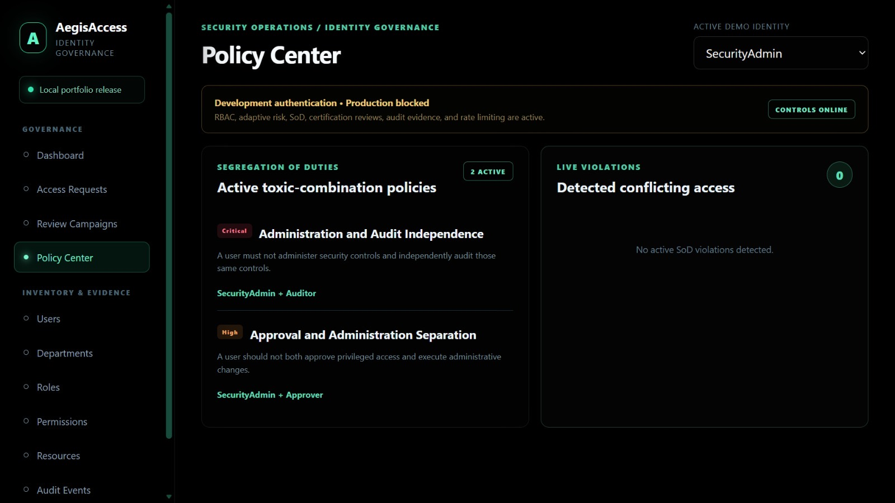

# AegisAccess

An Identity Governance and Administration portfolio platform for exploring access requests, role-based decisions, access reviews, and audit evidence.

**ASP.NET Core 10 · Entity Framework Core · SQLite · React · TypeScript · Vite · xUnit**

## What to explore

- Risk-aware access requests and approval decisions.
- Segregation-of-duties policy checks and self-approval prevention.
- Access review campaigns, certification, and revocation.
- Governance dashboards and audit evidence.

## Architecture

| Layer | Responsibility |
| --- | --- |
| [API](AegisAccess.Api) | Controllers, authentication, and request handling |
| [Application](AegisAccess.Application) | Contracts and application logic |
| [Domain](AegisAccess.Domain) | Core entities |
| [Infrastructure](AegisAccess.Infrastructure) | Persistence and service implementations |
| [Web](aegisaccess-web) | React interface |
| [Unit tests](AegisAccess.UnitTests) / [integration tests](AegisAccess.IntegrationTests) | Test projects |

## Run locally

Requirements: .NET 10 SDK, Node.js/npm compatible with the frontend dependencies, and two terminals.

Start the API in Development mode from the repository root (POSIX shell):

```sh
ASPNETCORE_ENVIRONMENT=Development dotnet run --project AegisAccess.Api --no-launch-profile --urls http://localhost:5091
```

On PowerShell, set `$env:ASPNETCORE_ENVIRONMENT="Development"` before running the same `dotnet run` command.

Start the frontend in a second terminal:

```sh
cd aegisaccess-web
npm ci
npm run dev
```

Open http://localhost:5173. The API configures a local SQLite database under `data/`. Keep the frontend origin consistent with the configured CORS policy.

## Build and tests

```sh
dotnet test AegisAccess.sln
cd aegisaccess-web
npm run build
```

These are project validation commands, not a claim that they passed in this documentation review.

## Security model

This is a demonstration platform. The API uses DemoAuth and intentionally refuses to start in Production. Review the [security decisions](docs/security-decisions.md), [threat model](docs/threat-model.md), and [architecture](docs/architecture.md) before extending it.

## Screenshots



<details>
<summary>Access requests, review campaigns, and policy center</summary>







</details>

## Further reading

- [Access governance](docs/access-governance.md)
- [Portfolio release notes](docs/portfolio-release.md)
- [Project state](PROJECT_STATE.md)
